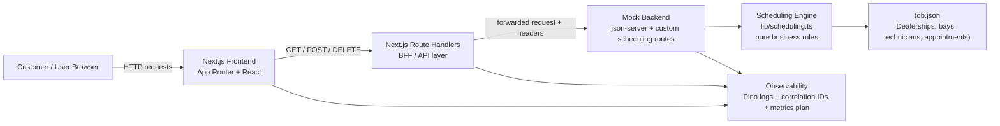

# Appointment Scheduler — System Design Document

## Quick start

### Prerequisites
- Node.js 20+
- npm 10+

### Install dependencies
```bash
npm install
```

### Run the app locally
```bash
npm run dev
```
This starts the mock backend and the Next.js app together. The UI is available at http://localhost:3000 and the mock API runs on http://localhost:3101 by default.

### Production build
```bash
npm run build
```

### Run the business-logic test suite
```bash
npm test
```

## AI Collaboration Narrative

Our strategy for guiding the AI was to keep the work scoped to the core scheduling domain and to validate every change with deterministic checks. We treated `lib/scheduling.ts` as the source of truth for availability and booking rules, and we used the test suite in `tests/scheduling.test.ts` as the guardrail for correctness.

The workflow was intentionally incremental: first confirm the bug or requirement, second isolate the smallest file or function involved, then apply a surgical fix and re-run the relevant tests. That reduced the risk of side effects and made it easier to confirm whether a change actually solved the problem.

We also verified output at multiple layers: unit tests for the scheduling engine, a production build for the Next.js app, and a local runtime check for the app startup. This gave confidence that the code was not only correct in isolation, but also still integrated properly in the real application flow.

Finally, the quality bar was enforced by keeping the business logic pure and deterministic, documenting assumptions in the README, and ensuring the final result still passed the project checks before completion.

## 1. Overview

This system is an appointment-booking platform for a dealership service center. The primary business requirement is to allow a customer to pick a service, vehicle, dealership, and time slot, then reserve an appointment only when both a valid service bay and a qualified technician are free for the full duration of the job.

The design intentionally separates the scheduling rules from the web layer. Business logic is implemented as pure TypeScript functions and validated with deterministic tests, while the web app and mock backend act as orchestration layers around that logic.

## 2. System Context

The application is composed of:

- A browser-based frontend served by Next.js
- A server-side BFF (backend-for-frontend) layer in Next.js Route Handlers
- A mock backend that exposes appointment and availability APIs
- A pure scheduling engine that enforces business rules
- A local JSON data store for reference data and persisted appointments

## 3. Architecture Diagram



## 4. Component Responsibilities

| Component | Role | Responsibility |
|---|---|---|
| Browser | Client entry point | Renders the booking UI, sends slot and booking requests, shows availability results |
| Next.js Frontend | Presentation and server-side rendering | Loads reference data for the page, renders the appointment form, triggers availability checks |
| Next.js Route Handlers (BFF) | API aggregation layer | Proxies requests to the backend, adds trace headers, handles 502 fallback for backend outages |
| Mock Backend | Scheduling service and data service | Validates availability, books appointments, cancels bookings, persists data in JSON |
| Scheduling Engine | Core domain logic | Implements time-window checks, technician assignment rules, bay constraints, overlap detection, and idempotency |
| db.json | Persistence layer for demo environment | Stores dealership metadata, customers, vehicles, service types, bays, technicians, and appointments |
| Pino logger | Observability | Records request-level structured logs with correlation IDs and timing |

## 5. Data Flow

### 5.1 Initial page load

1. The customer opens the dashboard page.
2. The Next.js server fetches reference data from the mock backend for:
   - dealerships
   - customers
   - vehicles
   - service types
   - bays
   - technicians
3. The page renders a booking form with the selected customer and their available vehicles.

### 5.2 Slot discovery

1. The user selects dealership, service type, and a date.
2. The frontend sends a request to the slot-generation API.
3. The backend computes a 30-minute slot grid inside operating hours.
4. Each slot is marked as available or unavailable based on:
   - dealership opening hours
   - service duration
   - bay type compatibility
   - technician skill compatibility
   - overlap with existing confirmed appointments
   - whether the slot is in the past
5. The result is returned to the UI and shown as selectable or unavailable slots.

### 5.3 Booking request

1. The user submits the chosen start time.
2. The system re-checks that the slot is still free.
3. The scheduling engine validates:
   - customer owns the selected vehicle
   - service and dealership references are valid
   - requested time is not in the past
   - the service still fits within opening hours
   - at least one suitable bay and one qualified technician are available for the full duration
4. If available, the engine selects:
   - the lowest-load technician for that day
   - the first suitable free bay
5. A new appointment record is persisted as `CONFIRMED`.
6. If the slot is taken by a race condition, the API responds with a conflict error and suggested alternatives.

### 5.4 Cancellation

1. The user cancels an appointment.
2. The backend marks the appointment status as `CANCELLED`.
3. The bay and technician become available again for future slots.

## 6. Core Design Decisions

### 6.1 Separation of business logic from transport concerns

The pure scheduling module in `lib/scheduling.ts` contains the business rules only. It does not access the filesystem, network, or clock directly. Instead, callers pass `now` and IDs in, making the logic deterministic and easy to test.

This is an important design choice because it allows testing of the scheduling outcomes without needing to boot the web server.

### 6.2 Single source of truth for conflict detection

Availability and booking are derived from the same domain rules. This keeps the system consistent:

- checking a slot
- reserving a slot
- notifying the user of alternatives

all go through the same scheduling algorithm.

### 6.3 Idempotency and retry safety

The booking flow supports repeated requests with the same `idempotency-key`. If the same booking request arrives again, the system returns the original appointment instead of creating a duplicate record.

This reduces user confusion and protects against double-submission issues.

## 7. Chosen Technologies and Why

| Technology | Why it was chosen |
|---|---|
| Next.js 16 | Provides the main UI framework, server rendering, route handlers, and a clean app structure for a modern web product |
| React 19 | Enables a component-driven UI with predictable state handling and a strong ecosystem |
| TypeScript | Adds type safety across the UI, API layer, and scheduling domain, reducing runtime bugs |
| json-server | Fast way to mock backend data and APIs during design and demo validation without setting up a database early |
| Pino | Structured, production-friendly logging with JSON output and request metadata |
| Vitest | Lightweight and deterministic unit testing for pure scheduling logic with no I/O dependency |
| Node.js | Appropriate runtime for both the web app and the mock service |
| db.json | Simple persistence for a prototype or demo environment, especially when the focus is on business rules |

## 8. Observability Strategy

The current implementation already includes a solid foundation for operational visibility, and the design leaves room for production hardening.

### 8.1 Logging

- All mock backend requests emit structured log entries with:
  - method
  - path
  - status code
  - elapsed duration
  - correlation ID
- Log events include business outcomes such as:
  - slot inspection
  - availability checked
  - appointment created
  - appointment rejected
  - appointment cancelled

### 8.2 Correlation and traceability

The system forwards a `x-correlation-id` header from the client-facing layer to the mock backend. This helps connect end-user activity to backend events even when multiple requests are made during the same booking flow.

`idempotency-key` is also propagated to support retried requests without duplicate appointment creation.

### 8.3 Metrics to add in production

Future production improvements should include:

- request rate by endpoint
- booking success vs conflict rate
- average availability-check latency
- number of `NO_BAY`, `NO_TECHNICIAN`, and `NO_BAY_AND_TECHNICIAN` outcomes
- cancellation rate by dealership or service type

These metrics are easy to expose via Prometheus or OpenTelemetry and can be visualized in Grafana.

### 8.4 Tracing

In production, OpenTelemetry tracing should be added across:

- frontend requests
- backend API calls
- scheduling function invocations
- persistence operations

This will make it easier to diagnose slow availability checks or inconsistent booking behavior under concurrent traffic.

## 9. Non-Functional Requirements and Trade-offs

### Scalability

This version is designed for a small demo or internal workflow, not high-scale production traffic. The current file-based storage and mock backend are enough for validation but would need a relational database and transactional constraints in a production deployment.

### Reliability

The business rules are deterministic and tested. The file-based storage is a limitation because it lacks atomic transactions. In production, a PostgreSQL database with exclusion constraints or a reservation table would better protect against double-booking.

### Security

The current demo does not include authentication, role-based access control, or full input validation. For real deployment, it would need:

- authenticated customer sessions
- authorization on booking and cancellation
- input validation on all request payloads
- protection against abuse and automated requests

## 10. GenAI Usage in the Design Phase

I used GenAI as a design partner rather than as a replacement for architectural judgment. The workflow was structured as follows:

1. Requirement clarification
   - I asked the AI to restate the business behavior and identify ambiguous assumptions.
   - Key points clarified included: one technician vs multiple technicians, time-zone handling, bay requirements, and whether appointments can overlap in a back-to-back manner.

2. Architecture decomposition
   - I had the AI break the system into frontend, BFF, backend, scheduling engine, and persistence layers.
   - The goal was to keep the business logic separate from presentation and transport concerns.

3. Rule extraction into a pure domain model
   - The AI helped translate the scheduling requirements into a deterministic logic model in `lib/scheduling.ts`.
   - This produced a design that is easier to reason about and easier to test.

4. Test-first validation thinking
   - Instead of generating code blindly, I used the AI to identify edge cases such as:
     - back-to-back intervals
     - partial overlaps
     - shift ending mid-service
     - bay or technician unavailable
     - duplicate retry requests
     - route-handling failure cases
   - These scenarios were turned into Vitest coverage and ensured the domain logic remained robust.

5. Iterative refinement
   - I reviewed the AI-generated structure against actual constraints of the project, such as the use of Next.js, json-server, and the existing mock backend pattern.
   - This allowed the architecture to remain consistent with the repo rather than drifting into an over-engineered enterprise design.

6. Documentation support
   - The AI helped draft this System Design Document, including the architecture diagram, component roles, data flow, and observability plan.
   - Final decisions were then reviewed manually to align with the actual application behavior.

The result was a design that is clearer, easier to validate, and consistent with both the project’s demo nature and the real scheduling constraints.

## 11. Summary

This system is designed around a strong separation between presentation, API orchestration, and the scheduling domain. The most important architectural strength is that the appointment rules are modeled in a pure, deterministic module that can be validated without runtime noise.

The current implementation is a solid prototype and a strong foundation for a production-grade version, but it still needs database transactions, authentication, and more complete observability before it is ready for real-world production use.
